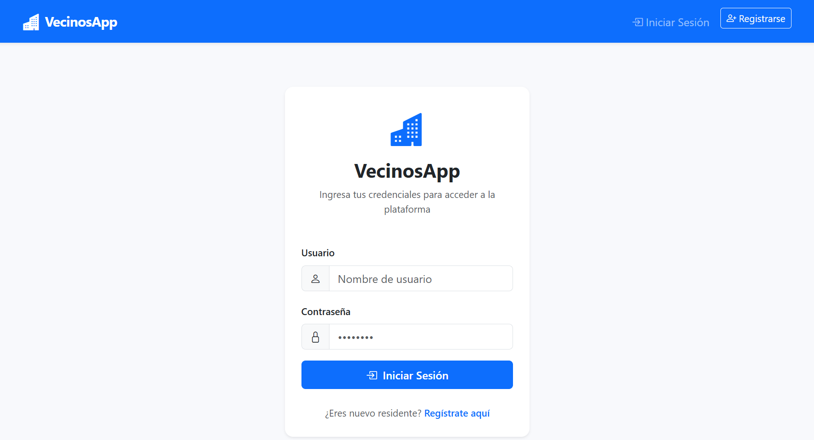
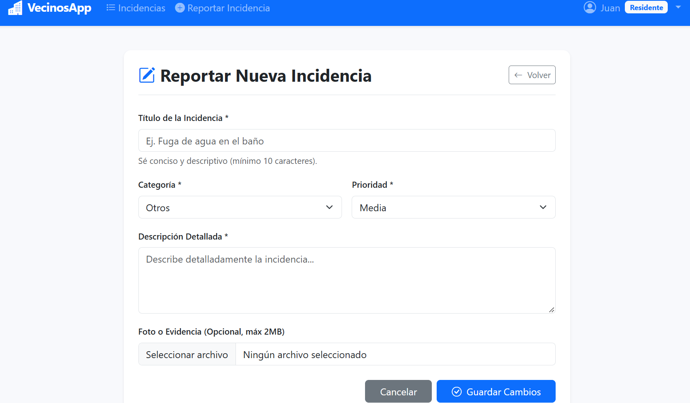
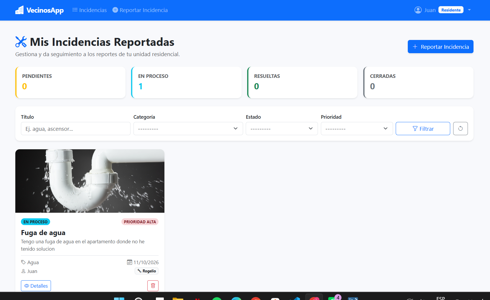
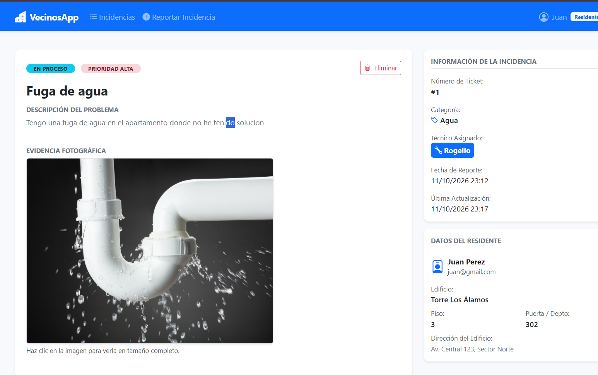
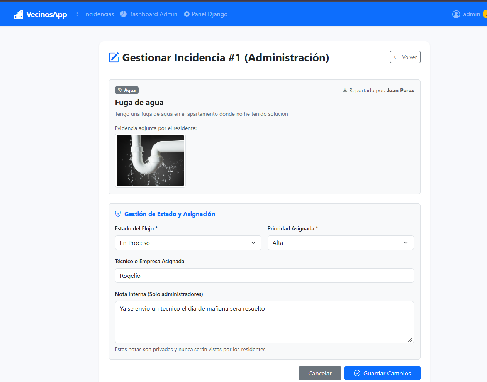

VecinosApp - Plataforma Web para Gestión de Incidencias en Edificios
Plataforma web desarrollada en Django diseñada para la administración de condominios y edificios residenciales. Permite a los residentes reportar incidencias dentro de su copropiedad y a la administración hacerles seguimiento, cambiar sus estados, asignar técnicos encargados y gestionar la comunicación en tiempo real.

Características y Requerimientos Implementados
1. Autenticación, Roles y Perfiles
Roles mediante Grupos de Django: Se establecieron dos grupos principales: Residente y Administrador.
Registro de Residentes: Formulario de registro que asocia automáticamente al usuario con el grupo Residente y genera su perfil vinculado a su edificio, piso y número de departamento.
Sesiones y Perfil: Funcionalidades de login, logout y visualización de perfil con datos del departamento.
2. Gestión de Incidencias (CRUD y Flujo de Trabajo)
Creación: Formulario para residentes con validación de título (mínimo 10 caracteres), categoría (Agua, Electricidad, Limpieza, Seguridad, Otros), prioridad (Baja, Media, Alta), descripción detallada y carga opcional de imagen (máximo 2 MB).
Flujo de Estados: Transición controlada: Pendiente -> En Proceso -> Resuelta -> Cerrada.
Control de Acceso y Edición:
Residentes: Visualizan únicamente sus reportes. Solo pueden editar una incidencia si se encuentra en estado Pendiente. Tienen opción de eliminar sus propios reportes mediante pantalla de confirmación.
Administradores: Tienen visibilidad de todas las incidencias de los edificios. Pueden cambiar el estado, asignar técnicos, definir prioridades y registrar notas internas privadas. No pueden alterar el título, la descripción ni la evidencia original enviada por el residente.
Seguimiento y Comentarios: Hilo de mensajes en cada incidencia para la comunicación directa entre el residente y la administración.
3. Características Adicionales
Filtros y Búsqueda: Integración con django-filter para consultar reportes por título, categoría, estado y prioridad.
Notificaciones por Correo: Señales de Django (post_save) configuradas para enviar una notificación por correo al residente cuando su incidencia cambia de estado o queda resuelta.
Dashboard con Gráficos: Panel estadístico para administradores con gráficos interactivos usando Chart.js que muestran la distribución por categorías y estados.
Paginación: Implementación con vistas basadas en clases (ListView) para ordenar los reportes.
Panel de Administración: Personalización de admin.py con filtros avanzados, buscador, columnas informativas e historial de comentarios en línea.

Guía de Instalación y Puesta en Marcha
Prerrequisitos
Python 3.10 o superior.
Servidor MySQL local (XAMPP o MySQL Server).

1. Clonar el repositorio
bash
git clone <https://github.com/lunxiomara/Vecinos_app.git>
cd Vecinos_app
2. Crear y activar el entorno virtual

En Windows (PowerShell):

powershell
python -m venv venv
.\venv\Scripts\Activate.ps1

En Linux o macOS:

bash
python3 -m venv venv
source venv/bin/activate
3. Instalar dependencias
bash
pip install -r requirements.txt
4. Configurar la base de datos MySQL

Crear la base de datos en MySQL Workbench o phpMyAdmin:

sql
CREATE DATABASE vecinos_db CHARACTER SET utf8mb4 COLLATE utf8mb4_unicode_ci;

Verificar que las credenciales en vecinosapp/settings.py coincidan con el usuario y contraseña de su servidor local.

5. Aplicar migraciones
bash
python manage.py makemigrations
python manage.py migrate
6. Crear el usuario Administrador
bash
python manage.py createsuperuser
7. Iniciar el servidor
bash
python manage.py runserver

Acceso al aplicativo:

Plataforma web: http://127.0.0.1:8000/
Panel de administración Django: http://127.0.0.1:8000/admin/

Estructura del Proyecto
text
Vecinos_app/
│── manage.py
│── requirements.txt
│── README.md
│── media/                 # Almacenamiento de archivos y fotos
│── static/                # Archivos estáticos
│── vecinosapp/            # Configuración principal del proyecto
│   │── settings.py
│   │── urls.py
│   └── wsgi.py
└── incidencias/           # Aplicación de incidencias
    │── models.py          # Modelos de datos
    │── forms.py           # Formularios y validaciones
    │── views.py           # Vistas basadas en clases (CBVs)
    │── urls.py            # Rutas de la aplicación
    │── filters.py         # Configuración de filtros
    │── signals.py         # Señales de notificación
    │── admin.py           # Configuración del panel de administración
    └── templates/incidencias/

    ---

Capturas de Pantalla de la Interfaz

1. Inicio de Sesión

2. Reporte de Incidencias (Residente)

2. Listado de Incidencias con Estados y Filtros

4. Detalle de Incidencia e Historial de Mensajes

5. Gestión Administrativa (Cambio de Estado, Técnico y Notas)
